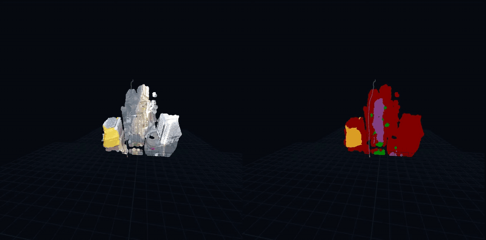
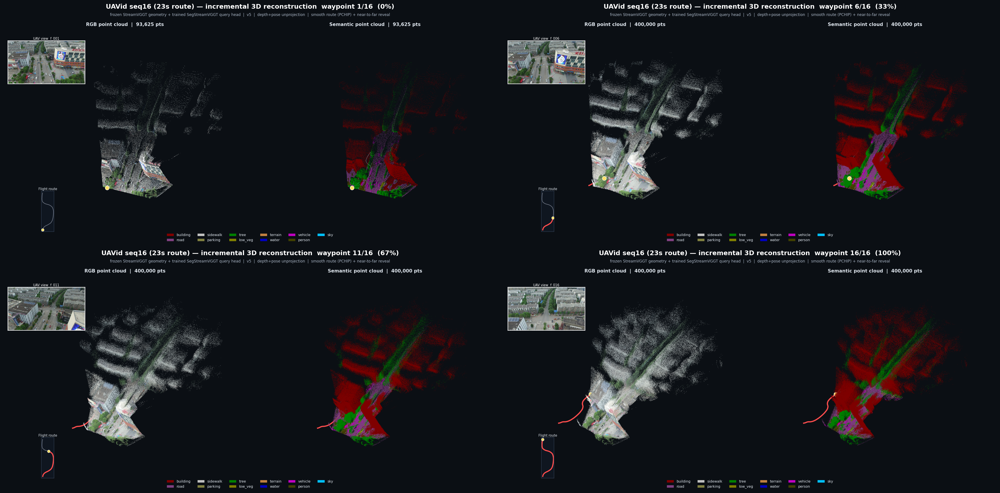

<p align="center">
  
  <br>
  <sub><b>Streaming 3D reconstruction (left) + query-based semantic segmentation (right) on UAV video.</b></sub>
</p>

---

# SegStreamVGGT: 多个航拍数据集的 Query 语义分割

在 [StreamVGGT](https://github.com/wzzheng/StreamVGGT)（ICLR 2026 *Streaming 4D Visual Geometry Transformer*）
的基础上，模仿 [SegVGGT](https://github.com/IDEA-Research/SegVGGT) 的结构，用 **object query**
对 `/data1/luhangze/AIC/` 下 **7 个航拍/无人机语义分割数据集** 做统一闭集（AIC-11）的语义分割训练。

> **一句话**：冻结 StreamVGGT 主干 → 学习 100 个 object query 逐层 cross-attend 到几何 token →
> query 与 dense feature 点积得到 per-query mask + query 分类 → Mask2Former 式组合成逐像素语义概率；
> 只训练 query 分支（54.8M / 963.9M = 5.7%）。

> **v5 结果（2026-10-19）**：全图评测 ALL **0.7218**（v3 同口径 0.6317，v4 0.6916）；
> Potsdam 0.8059、HD-Maps 0.6414、sidewalk IoU 0.437、parking 0.493；训练/评测改进见 [§9](#9-v4-数据训练评测改进2026-10-19) / [§10](#10-v5-调参class-weight-cap-5--dstl-收窄)。

> 📄 **改进与创新的技术总结见 [TECHNICAL_NOTES.md](TECHNICAL_NOTES.md)**（含 query 塔缩的诊断与修复、多帧 tile-grid、
> 部分标签屏蔽、分阶段课程、crop 预算 epoch、dstl 16-bit TIFF 修正等 8 项改进的动机/实现/实测证据）。

---

## 目录

- [1. 项目结构](#1-项目结构)
- [2. 环境与权重](#2-环境与权重)
- [3. 数据准备 (precache)](#3-数据准备-precache)
- [4. 模型结构](#4-模型结构)
- [5. 训练](#5-训练)（含 [5.1 分阶段课程](#51-分阶段课程训练推荐默认已内置) / [5.6 epoch 语义](#56-一个-epoch--一次前向到底是什么重要)）
- [6. 评测与可视化](#6-评测与可视化)
- [7. 与 `aic/README.md` 的对应关系](#7-与-aicreadmemd-的对应关系)
- [8. 已知限制与后续工作](#8-已知限制与后续工作)
- [9. v4 数据/训练/评测改进（2026-10-19）](#9-v4-数据训练评测改进2026-10-19)
- [10. v5 调参（class-weight cap 5 + dstl 收窄）](#10-v5-调参class-weight-cap-5--dstl-收窄)
- [11. 3D 点云 / 分割点云 demo](#11-3d-点云--分割点云-demo)
- **[TECHNICAL_NOTES.md](TECHNICAL_NOTES.md)：改进与创新的技术总结（推荐先读）**

---

## 1. 项目结构

```
/data/luhangze/aic/
├── README.md                  # AIC 7 数据集标签映射指南 (上游文档)
├── label_mapping.py           # AIC 统一标签映射 (纯 numpy+PIL)
├── StreamVGGT/                # 上游 StreamVGGT 仓库 (git clone, 未改动)
│   └── ckpt/checkpoints.pth   # StreamVGGT 预训练权重 (5.03 GB, HuggingFace lch01/StreamVGGT)
└── SegStreamVGGT/             # ★ 本项目
    ├── segstreamvggt/         #   模型包 (从 StreamVGGT 复制并按 SegVGGT 风格扩展)
    │   ├── models/
    │   │   ├── aggregator.py      # StreamVGGT aggregator (+ object query 分支)
    │   │   ├── streamvggt.py      # 上游原模型 (保留作参考)
    │   │   └── segstreamvggt.py   # ★ SegStreamVGGT = aggregator + query 分支 + 语义头
    │   ├── heads/
    │   │   └── semantic_head.py   # ★ DPT 融合 + query mask/分类 (仿 SegVGGT SemanticHead)
    │   ├── layers/                # attention (含 CrossAttention) / block (含 CrossBlock) / rope / ViT
    │   └── utils/
    ├── aic_data/              #   数据管线
    │   ├── registry.py            # 7 数据集登记表 + 每个数据集真实标注类 C_d
    │   ├── precache.py            # ★ 原始数据 -> 统一缓存 (标签映射只做一次)
    │   ├── dataset.py             # torch Dataset: 联合采样/多帧/增强/部分标签
    │   └── losses.py              # 按数据集屏蔽类的 CE+Dice + 逐类 IoU 统计
    ├── cache/                 #   预处理缓存 (~3.1 GB)
    ├── train_aic.py           # ★ 训练 (单卡 / torchrun DDP / 分阶段课程 / query 诊断 / TensorBoard)
    ├── eval_aic.py            # ★ 评测 + 可视化 (逐数据集 mIoU / 逐类 IoU)
    ├── verify_pipeline.py     #   数据管线自检 (无需 GPU)
    ├── download_ckpt.py       #   权重下载脚本
    ├── TECHNICAL_NOTES.md     # ★ 改进与创新的技术总结
    └── README.md              #   本文件
```

---

## 2. 环境与权重

```bash
# 环境 (已验证): iggt env, torch 2.5.0+cu124
export PATH=/data/luhangze/miniconda3/envs/iggt/bin:$PATH
python -c "import torch; print(torch.__version__)"     # 2.5.0+cu124

# 依赖: torch / numpy / Pillow / tensorboard (可选)
pip install -r requirements.txt

# 权重 (已下载): StreamVGGT checkpoints.pth (5.03 GB)
python download_ckpt.py            # 从 HuggingFace lch01/StreamVGGT 拉取到 StreamVGGT/ckpt/
```

### 2.1 权重来源与冻结范围（可自检）

```bash
python check_setup.py                  # 默认配置: 主干来自预训练 + 只训分割部分
python check_setup.py --with-geometry 1 # 额外构建 depth/point head 并确认它们被冻结
```

**主干完全来自 StreamVGGT 预训练权重**（`StreamVGGT/ckpt/checkpoints.pth`，HuggingFace `lch01/StreamVGGT`，5.03 GB）：

```
[   ] 加载成功 (按模块):
[   ]   aggregator.            从 ckpt 载入 1209 个张量 | 未加载(新初始化) 1 个   预训练权重 ✅
[   ]   aggregator.query(分割) 从 ckpt 载入    0 个张量 | 未加载(新初始化) 579 个  ← 新分支
[   ]   semantic_head.         从 ckpt 载入    0 个张量 | 未加载(新初始化)  62 个  ← 新分支
[   ] patch_embed.pos_embed: 形状不符, 由插值自动处理 (输入分辨率不同, 正常)
```

**默认只训练分割部分，几何重建部分全部冻结**（`--train-scope seg`，`--freeze-backbone 1`）：

| 模块 | 参数量 | 状态 |
|---|---:|---|
| aggregator 主干（ViT-L patch embed + 24 frame + 24 global blocks） | 907.79 M | ❄️ 冻结 |
| aggregator.query（object query + CrossBlock × 24 + query_proj）**分割** | 22.21 M | ✅ 可训练 |
| semantic_head（DPT 融合 + query 分类）**分割** | 32.63 M | ✅ 可训练 |
| depth_head / point_head（几何，需 `--with-geometry 1` 才构建） | 32.65 M each | ❄️ 冻结 |
| **合计** | 962.6 M（含几何头 1027.9 M） | **可训练 54.84 M (5.70 %)** |

训练第一步后会自动校验：冻结张量无梯度、优化器只含可训练参数（日志 `[FREEZE] 校验通过`）。

| 训练范围 | 命令 | 说明 |
|---|---|---|
| 只训分割（**默认**） | `--train-scope seg` | 语义头 + query 分支；主干与几何头冻结且**不参与前向计算**（省算力） |
| 分割 + 几何头 | `--with-geometry 1 --train-scope seg+geometry` | 多任务；几何头用较低 lr（`--backbone-lr-mult`） |
| 全量微调 | `--train-scope all --freeze-backbone 0` | 主干也解冻（显存/时间大幅上升） |

---

## 3. 数据准备 (precache)

原始 7 个数据集的标签格式/颜色/索引互不相同（见 `../README.md` §3/§4.4），
**映射只做一次**：`precache` 把原始数据转成统一的

```
cache/<dataset>/<split>/img/<name>.jpg     # RGB (JPEG q95)
cache/<dataset>/<split>/lbl/<name>.png     # uint8 统一索引图 (AIC-11, 0=unlabeled)
cache/<dataset>/<split>/manifest.json      # [{"name","group","width","height"}, ...]
```

```bash
python -m aic_data.precache --datasets all --workers 8      # 全量约 3.7 分钟
python -m aic_data.precache --datasets uavid,dstl --verify 3 # 单数据集 + 抽样对齐验证图
```

### 3.1 缓存清单（已生成）

| dataset | 原始形态 | train | val | 说明 |
|---|---|---:|---:|---|
| uavid | 4K 斜视视频帧, RGB 彩色标签 | 200 | 70 | 官方划分 (20 val 序列 × 10 帧) |
| aeroscapes | 1280×720 低空, 索引 0–11 | 2621 | 648 | 官方 `ImageSets/{trn,val}.txt` |
| dlr3k | 5616×3744, `.samp` 旋转框 | 8 | 2 | **只有车辆框** → 栅格化成 vehicle mask, 其余 ignore |
| dlrsd | 256×256, 调色板 0–17 | 1680 | 420 | 2100 张按 8:2 确定性划分 |
| dstl | 1km 瓦片, WKT 多边形 | 20 | 5 | 25 瓦片按 8:2 划分; 影像 16-bit/planar TIFF 已修正 |
| potsdam | 6000×6000 真正射 5cm | 18 | 6 | 24 张有标注的按 8:2 划分 |
| hdmaps | 航拍 20 张, RGB 5 色 | 10 | 10 | 唯一有 sidewalk/parking 标注的数据集 |

**合计 train 4557 张 / val 1161 张。**

### 3.2 已修正的两个原始坑

1. **dstl 影像是 16-bit planar TIFF**：PIL 会把它当成 3 通道 8-bit 解码出棋盘伪影。
   现在用 `tifffile` 读 planar 数据 + 1–99 百分位对比度拉伸。
   *对齐校验*：标签边界梯度比 **1.833**（对齐参考区间 1.8–2.6，随机 mask = 1.00），
   叠加目视检查 road/building/tree 均与影像吻合（`precache --verify` 可复现）。
2. **扩展类默认关闭**：`label_mapping` 默认把 UAVid/Potsdam 的 clutter 映射到扩展类 12，
   缓存阶段凡 `>= num_classes(12)` 的 id 一律写成 0（ignore），与 AIC-11 闭集一致。

---

## 4. 模型结构

### 4.1 总览

```text
images (B,S,3,518,518)
   │
   ├─ StreamVGGT Aggregator (冻结) ────────────────┐  交替 frame / global(因果) attention ×24
   │                                                │  patch_start_idx=5 (camera+4 register)
   │                                                ▼
   │                                    tokens: 24 × (B,S,P,2048)
   │                                                │
   │   object queries (B,100,256) ──→ CrossBlock ×24 ┤  ← 每个 global block 后 cross-attend
   │        (可学习, std=1e-6)      (q:queries, kv:tokens, P 保持帧布局)
   │                                                │
   │                                                ▼
   │                     SemanticHead (DPT 融合: 4 层 token → 256→128 ch, H/4)
   │                                                │
   ├── query_proj(256→128) ── einsum ────────────────┤
   │                                                ▼
   │                              query_masks (B,100,S,h,w)  ← 逐 query mask logits
   │                              query_logits (B,100,12+1)  ← 逐 query 分类 (末位 = no-object)
   │                                                │
   └──────────────── Mask2Former 式组合 ─────────────┘
                       seg_prob (B,12,S,h,w)  ← 逐像素类别概率 (在类维归一化)
```

### 4.2 关键设计（与 SegVGGT 的对应）

| SegVGGT | 本项目 | 说明 |
|---|---|---|
| `Aggregator(enable_instance_seg, instance_query_num, cross_block_layers, ...)` | `Aggregator(enable_query_seg, query_num, cross_block_layers, ...)` | query 作为**独立张量**，不写回 token 序列 → 主干权重 100% 兼容 |
| `CrossBlock` + `CrossAttention` | 逐字移植（`layers/block.py`, `layers/attention.py`） | query=queries, kv=tokens, `P` 参数保留帧布局 → 可读回 `attn_frame_mean`（FADA 式帧注意力） |
| `query_self_attention` / `supervise_attend_frame` | 同样支持（CLI 开关） | |
| `SemanticHead` + `scratch.output_instance` + `instance_queries_proj` | `SemanticHead` + `query_proj` | query 与 dense feature 点积出 mask；分类 MLP 输出 `num_classes+1` |
| `instance_maps` / `instance_labels` | `query_masks` / `query_logits` → `seg_prob` | AIC 只有语义标签，故按 Mask2Former 语义模式组合：`p(c)=Σ_q softmax(cls)[q,c]·σ(mask[q])` 再在类维归一化 |
| LoRA | 暂未移植（可选后续） | `--freeze-backbone 0` 可直接全量微调主干（较低 lr） |

### 4.3 参数量与默认配置

| 组件 | 参数量 | 是否训练 |
|---|---:|---|
| StreamVGGT aggregator (24 frame + 24 global blocks, ViT-L patch embed) | ~880 M | ❄️ 冻结 |
| query 分支: `query_token`(100×256) + 24× CrossBlock(256-d) + `query_proj` | 54.8 M | ✅ |
| SemanticHead (DPT 融合 + query 分类 MLP) | ~26 M | ✅ |
| **总计** | **963.9 M** | **可训练 54.84 M (5.69%)** |

默认开关（`train_aic.py` 模块顶部常量 / CLI）：

| 参数 | 默认 | 含义 |
|---|---|---|
| `--num-queries` | 100 | object query 数 |
| `--query-dim` | 256 | query 维度 (Mask2Former 同款) |
| `--cross-dim/--cross-heads` | 256 / 8 | CrossBlock 注意力工作维度/头数（SegVGGT 用 1024 会到 300M+ 参数） |
| `--cross-block-layers` | 全部 24 个 global block | 如 `--cross-block-layers 12,15,18,21,23` 只在高分辨率层交互 |
| `--out-ratio` | 2 | 语义图/特征图分辨率 = H/2（259² mask，细窄道路更准） |
| `--num-frames` | 4 | 一次前向 4 个 crop；`tile-grid` 时是同一张图的 2×2 连续网格 |
| `--frames-mode` | tile-grid | tile-grid / sequence / same-scene / independent（见 §5.5） |
| `--img-size` | 518 | 支持 `518` / `518x728` / `728x728` 等（H/W 都是 14 的倍数） |
| `--val-num-frames` | 1 | 验证时逐 crop 评测（单图语义分割口径） |

### 4.4 逐 query 辅助监督（防止 query 塌缩）—— 实测必须开

只用「组合后的逐像素概率」做监督时存在**退化解**：让所有 query 预测同一类、mask 全开，
模型就退化成"每张图一个全局分类器"（完全没有空间分割）。本项目首次训练就踩到了：

```
[query 诊断] 每样本不同类别数 1.00/100 个 query, 平均 mask 面积 1.0000   # ← 塌缩
```

原因：SegVGGT / Mask2Former 靠**实例 GT 的 Hungarian 匹配**做逐 query 监督来避免它，
而 AIC 只有语义标签。因此本实现增加**固定分配 + 逐 query 监督**（`losses.query_aux_loss`）：

1. 每个 query 固定分配一个语义类：`q → 1 + q % (C-1)`（100 个 query / 11 类 ≈ 9 个/类）；
2. **逐 query 分类**：`CE(query_logits[q], 分配的类)` —— query 学会"我是哪一类"；
3. **逐 query mask**：`BCE + Dice(σ(query_masks[q]), labels == 该类)` —— query 学会"这类在哪里"；
4. 该数据集未标注的类（`valid_class=False`）不参与监督；仍保留组合层的 CE + Dice 作为主任务损失。

开关（默认全开，权重 1.0）：`--query-aux-weight` `--query-cls-weight` `--query-bce-weight` `--query-dice-weight`。

修复效果（400 crop 小测试，2 epoch）：query 类别数 1 → 2.2 → 4.2（逐步多样化），
平均 mask 面积 1.0 → 0.24–0.27（不再全开），val mIoU 0.127 → 0.218。
训练日志每个 LOG_EVERY 步会打印 `[q: Ncls areaX.XX]`，每个 epoch 验证后会打印完整诊断。

---

## 5. 训练

```bash
export PATH=/data/luhangze/miniconda3/envs/iggt/bin:$PATH

# 单卡
python train_aic.py --datasets all --epochs 12 --batch-size 3 --img-size 518 \
    --num-frames 4 --frames-mode tile-grid --max-samples 16000

# 多卡 (torchrun 自动 DDP) —— 4 卡示例
CUDA_VISIBLE_DEVICES=0,1,2,3 torchrun --nproc_per_node=4 train_aic.py \
    --datasets all --epochs 12 --batch-size 3 --img-size 518 \
    --num-frames 4 --frames-mode tile-grid --max-samples 32000 \
    --max-val-samples 400 --val-crops 4 --num-workers 6 --lr 3e-4 \
    --dataset-weight sqrt --out-ratio 2 --log-dir logs_aic_staged
```

#### 挂 tmux 自己跑（多卡推荐模板）

```bash
# 1) 起 tmux 会话 (断开 SSH 也不会死)
tmux new -s aicseg            # 之后用 tmux attach -t aicseg 回来看

# 2) 环境 (注意 PATH: shell 里有个空 venv 会在前面, 必须显式前插 conda env)
export PATH=/data/luhangze/miniconda3/envs/iggt/bin:$PATH
export PYTORCH_CUDA_ALLOC_CONF=expandable_segments:True
cd /data/luhangze/aic/SegStreamVGGT

# 3) 8 卡启动 (按需改 CUDA_VISIBLE_DEVICES / nproc_per_node)
CUDA_VISIBLE_DEVICES=0,1,2,3,4,5,6,7 torchrun --nproc_per_node=8 --master_port=29555 \
  train_aic.py --datasets all --epochs 12 --batch-size 3 --img-size 518 \
  --num-frames 4 --frames-mode tile-grid --max-samples 64000 \
  --max-val-samples 400 --val-crops 4 --num-workers 6 --lr 3e-4 \
  --dataset-weight sqrt --out-ratio 2 --log-dir logs_aic_staged 2>&1 | tee logs_aic_staged.txt
```

**显存/时间参考**（518²、S=4、B=3、out-ratio 2）：

| 项 | 数值 |
|---|---|
| 每卡显存 | **≈29 GiB**（B=3）；B=2 ≈ 22 GiB；B=4 ≈ 36 GiB（48G 卡可，但留点余量更稳） |
| 每卡步数 | `max-samples / (num_frames × batch × world)` |
| 单步耗时 | 独占 4090 ≈ 0.9 s；与他人共享 ≈ 1.8 s（实测 0,1 卡） |
| 每 epoch 时间 | 16000 crop / 4 帧 / 3 batch / 8 卡 = 167 步 ≈ **2.5 min**（独占） |
| 12 epoch 总时长 | 8 卡 ≈ 35~70 min；4 卡 ≈ 1.2~2.3 h；2 卡（共享）≈ 4 h |

> OOM 时优先降 `--batch-size`（3→2），其次升 `--num-workers` 无用（OOM 是显存不是内存）。
> 断点续训：`--resume logs_aic_staged/checkpoint_last.pth`（会恢复 epoch/优化器/scheduler/best mIoU）。

### 5.1 分阶段课程训练（推荐默认，已内置）

类别覆盖率在 7 个数据集间极不均匀（实测：6/7 = building/road/vehicle，4~5/7 = tree/low_vegetation，
1~2/7 = sidewalk/parking/terrain/water/person/sky）。因此默认开启**课程**：先训常见类，再逐步加稀有的类。

| 阶段 | 监督的类 | epoch (auto) | 依据 |
|---|---|---:|---|
| stage 1 | `{1 building, 2 road, 9 vehicle}` | 3 | **几乎所有训练集都有的常见类**（6/7） |
| stage 2 | `+ {5 tree, 6 low_vegetation}` | 2 | 大部分训练集有（4~5/7） |
| stage 3 | `+ {3,4,7,8,10,11}` → **AIC-11 全部** | 7 | 补齐 |

- 阶段**单调递增** → 不会出现"学新类忘旧类"；
- 切换时同步更新：loss 类掩码（$C_d \cap$ 本阶段）、标签 LUT（阶段外类→ignore）、**query 类别分配**；
- 日志：`[CURRICULUM] stage k: ...`、`[CURRICULUM] >>> epoch N: 进入 stage k`、`[stage k] 本阶段类平均 IoU`；
- 自定义：`--stage-coverage 0.85,0.5,0`、`--stage-epochs 3,2,7`、`--stage-classes "1,2,9;1,2,5,6,9;all"`；
- 关闭：`--no-curriculum 1`（一次性监督全部类，等价于普通训练）。

### 5.2 超参（与 `DPT_Up`/`vggt-up/train_depth.py` 同风格）

| 参数 | 值 | 说明 |
|---|---|---|
| `--img-size` | 518 | = 37×14，与预训练分辨率一致（patch_embed.pos_embed 无需插值） |
| `--batch-size` | 6 | 每卡 crop 数（实测 518² 时 11.9 GiB / 卡，66 ms/sample） |
| `--max-samples` | 14000 | **每个 epoch 的 crop 预算**（可大于图片数，有放回重采样；4557 张图 → 约 3× 过采样） |
| `--epochs` | 12 | |
| `--lr` / `--min-lr` | 3e-4 / 1e-6 | AdamW，warmup 1 epoch + cosine 退火 |
| `--weight-decay` | 0.05 | |
| `--dataset-weight` | sqrt | 数据集间采样 ∝ √N_d（README §6.1 推荐；`equal`/`natural` 可选） |
| `--val-crops` | 4 | 每张验证图最多 4 个 crop；`--max-val-samples 400` 分层抽样 |

### 5.3 部分标签 (partial-label) 处理 — 最容易犯错的点

`aic/README.md` §6.2：**某数据集不含某类 ≠ 该类是负样本**。实现方式：

1. 每个数据集在 `aic_data/registry.py` 里声明自己**真正标注过的类** `classes`（= C_d）；
2. `Dataset.__getitem__` 返回 `valid_class` (C,) bool；
3. `losses.masked_prob()` 把**未标注类别的概率置 0 并重新归一化**再算 CE/Dice；
4. 评测时同样屏蔽（`eval_aic.py` 的 argmax），避免未标注类把 IoU 拉到 0。

各数据集的 C_d（现网生效值，训练日志会打印）：

| dataset | C_d |
|---|---|
| uavid | building, road, tree, low_vegetation, vehicle, person |
| aeroscapes | building, road, tree, vehicle, person, sky |
| dlr3k | vehicle |
| dlrsd | building, road, tree, low_vegetation, terrain, water, vehicle |
| dstl | building, road, tree, low_vegetation, water, vehicle |
| potsdam | building, road, tree, low_vegetation, vehicle |
| hdmaps | building, road, sidewalk, parking |

### 5.4 增强

随机尺度裁剪（`--scale-min/--scale-max 0.5/1.6`，更小的 crop 相当于模拟更大 GSD）+
水平翻转(0.5) + 垂直翻转(0.2) + 90° 旋转(0.75)——航拍视角下这些变换都是**语义等价**的。
训练 loss 在 **H/4 特征图**上计算（`--loss-res feat`，省显存）；评测时双线性上采样回原分辨率。

### 5.5 日志

- `logs_aic/metrics.csv`、`last_metrics.json`（逐 epoch val mIoU / 逐数据集 mIoU）
- `logs_aic/tensorboard/`：`tensorboard --logdir logs_aic/tensorboard --port 6008`
- `logs_aic/checkpoint_last.pth` / `checkpoint_best.pth`（按 val mIoU；**完整模型 3.8 GB**，
  `--save-trainable-only 1` 可只存 0.22 GB 的 query 分支）
- `logs_aic_train.txt`（重定向的完整 stdout）

### 5.6 一个 epoch / 一次前向到底是什么（重要）

**一次前向 = `--num-frames` 个 crop**（默认 4），而不是单张 518² —— StreamVGGT 本身支持
**任意帧数 × 任意分辨率**的输入，所以大图不是只能"切一块"，而是**一组连续小块**一起送进去：

| `--frames-mode` | 一"帧组"的来源 | 用途 |
|---|---|---|
| `tile-grid`（默认） | **同一张大图上连续铺开的 gh×gw 网格**（S=4 → 2×2，覆盖 1036×1036 连续区域） | 覆盖范围 = S × 输入面积，帧间空间相邻，几何注意力有用 |
| `sequence` | 同一 `group`（UAVid 序列 / HD-Maps 序列 / AeroScapes 片段 / DLRSD 场景）内的**连续帧** | 真正的视频流式训练（StreamVGGT 的原始场景） |
| `same-scene` | 同一张图的随机位置 crop | 同场景多视角 |
| `independent` | 同数据集内另一张图的随机 crop | 最弱的耦合 |

**一个 epoch ≠ 把数据集过一遍**：`--max-samples` 是「每 epoch 的 **crop** 预算」，
样本数 = 预算 / num_frames，每个 epoch 用 `seed+epoch` 重新随机抽（有放回）。
大图（Potsdam 6000²、UAVid 4K、dstl 3.3k²、HD-Maps 4500²）无法整张送入，
所以 1 个 crop = 一张图内的一块 `img_h×img_w` 区域；小图（DLRSD 256²）一个 crop 就是整图。

**输入分辨率也不限于 518²**：`--img-size` 支持 `518`、`518x728`、`728x728` 等（H/W 都需是 14 的倍数），
patch_embed 的 position embedding 会自动按实际网格插值。大图的另一种处理方式是**降分辨率**
（用 `--scale-max` 允许裁一块比输入更大的区域再缩放进来，相当于大 GSD 的全局上下文）。

默认 `--num-frames 4 --frames-mode tile-grid --max-samples 16000` 时的实际分配（训练日志会原样打印）：

| dataset | 图片数 | 采样占比 | 每 epoch crop | crop/图 |
|---|---:|---:|---:|---:|
| uavid | 200 | 11.7% | 1869 | 9.3 |
| aeroscapes | 2621 | 42.3% | 6768 | 2.6 |
| dlr3k | 8 | 2.3% | 374 | 46.8 |
| dlrsd | 1680 | 33.9% | 5419 | 3.2 |
| dstl | 20 | 3.7% | 591 | 29.6 |
| potsdam | 18 | 3.5% | 561 | 31.2 |
| hdmaps | 10 | 2.6% | 418 | 41.8 |

> 想「更彻底地用数据」就调大 `--max-samples`（每 epoch 的 crop 数），而不是改 epoch 语义；
> 想更快就调小它或减少 `--epochs`（每个 epoch 都会存 `checkpoint_best.pth`，可随时提前停）。
> 帧数 S 越大，global attention 的 O((S·P)²) 项越贵 —— S=4 时约 1.8 s/step（B=3，共享 4090）；
> S=1 时约 0.85 s/step（B=6，同样 6 帧/step 吞吐相近），所以 S 的收益在**覆盖面与多帧上下文**，不在速度。

---

## 6. 评测与可视化
```bash
# 逐数据集 mIoU + 逐类 IoU + 可视化 (默认输出到 <ckpt 目录>/eval_aic)
python eval_aic.py --ckpt logs_aic_v4/checkpoint_best.pth --num-viz 8

# v4 正式数字: 全图覆盖 (所有不重叠 518 crop) + 与训练一致的 out_ratio=2
python eval_aic.py --ckpt logs_aic_v4/checkpoint_best.pth \
    --full-image 1 --out-ratio 2 --max-val-samples 0 --num-viz 8

# 同时评测"未训练 baseline"(随机 query 分支), 打印训练前后对比
python eval_aic.py --ckpt logs_aic_v4/checkpoint_best.pth --baseline

# 只评测部分数据集 / 控制样本量 (默认 out_ratio 已与训练对齐为 2)
python eval_aic.py --ckpt logs_aic_v4/checkpoint_best.pth \
    --datasets uavid,potsdam,hdmaps --max-val-samples 200
```

输出：

- `metrics_table.txt`（便读表格，形如）：

```
dataset         mIoU  buildi    road  sidewa  parkin    tree  low_ve  terrai   water  vehicl  person     sky
--------------------------------------------------------------------------------------
uavid         x.xxxx   ...
...
ALL           x.xxxx   ...
```

- `metrics.json`：逐数据集/逐类 IoU、loss、args
- `viz/frame_XX_<dataset>_<image>.png`：**RGB | GT(伪彩) | 预测(伪彩) | 置信度** 四联图

### 6.1 数据管线自检（不需要 GPU）

```bash
python verify_pipeline.py                       # 7 数据集 × train/val 全查
python verify_pipeline.py --num-frames 2 --frames-mode same-scene
```

检查：缓存可读、标签 id ⊆ {0} ∪ C_d（扩展类不会漏进来）、`valid_class` 与 registry 一致、
图/标签同步裁剪、多帧模式形状正确。

### 6.2 已完成的 v3 训练（2026-10-09，旧配置）

v3 是旧方案最后一次完整训练（2×4090，8 epoch 分阶段课程，32k crop/epoch，主干冻结）：

```bash
CUDA_VISIBLE_DEVICES=0,1 torchrun --nproc_per_node=2 train_aic.py \
    --datasets all --epochs 8 --batch-size 3 --img-size 518 \
    --num-frames 6 --frames-mode tile-grid --max-samples 32000 \
    --max-val-samples 400 --val-crops 4 --num-workers 6 --lr 3e-4 \
    --dataset-weight sqrt --out-ratio 2 --log-dir logs_aic_staged
```

- 日志：[logs_aic_staged.txt](logs_aic_staged.txt)（ep1–4）、[logs_aic_staged_resume.txt](logs_aic_staged_resume.txt)（ep5–8）
- 最佳权重：[logs_aic_staged/checkpoint_best.pth](logs_aic_staged/checkpoint_best.pth) = **epoch 4, val mIoU 0.6532**
- 过拟合的 epoch 8 权重（`checkpoint_last.pth`，val 0.5594）已按 v4 计划删除

| dataset | ep4（best） | ep8（final） |
|---|---:|---:|
| uavid | 0.6767 | 0.6455 |
| aeroscapes | **0.8405** | 0.5296 |
| dlr3k | 1.0000 | 1.0000 |
| dlrsd | 0.7058 | 0.6209 |
| dstl | 0.3820 | 0.5121 |
| potsdam | 0.7335 | 0.7651 |
| hdmaps | 0.3548 | 0.4592 |
| **11 类平均** | **0.6532** | 0.5594 |
| 日志 `mIoU(all)` | 0.6532 | 0.5128* |

\* ep5 起模型开始预测 ignore 类 0（IoU 必为 0），把 `mIoU(all)` 拉低；同口径 11 类平均是 0.5594。

> ⚠️ v3 的验证只用了 **400 个 crop**（按数据集比例分层，Potsdam 只有 5 个 crop、HD-Maps 8 个），
> 逐数据集数字噪声很大；这本身是 v4 要修的缺陷之一。v3 的 `checkpoint_best` 只作为 v4 的
> warm-start 初始化与对照基线，不再作为最终结果。

### 6.2.1 同口径全图评测（v3 ep4，供 v4 对照）

用 v4 的全图口径重评 v3 ep4（`--full-image 1 --out-ratio 2 --max-val-samples 0`，
5,483 个不重叠 518 crop；结果在 [logs_aic_staged/eval_full](logs_aic_staged/eval_full)）：

| dataset | v3 400-crop（旧日志） | v3 full-image（新口径） |
|---|---:|---:|
| uavid | 0.6767 | 0.7302 |
| aeroscapes | 0.8405 | 0.8363 |
| dlr3k | 1.0000 | 1.0000 |
| dlrsd | 0.7058 | 0.6951 |
| dstl | 0.3820 | 0.4769 |
| potsdam | 0.7335 | 0.7286 |
| hdmaps | 0.3548 | 0.4212 |
| **ALL（11 类平均）** | **0.6532** | **0.6317** |

逐类 IoU（全图，ALL）：building 0.846、road 0.806、sidewalk **0.001**、parking 0.188、
tree 0.809、low_veg 0.641、terrain 0.506、water 0.830、vehicle 0.807、person 0.605、sky 0.911。

> 这说明旧日志的 0.6532 略偏乐观（400 个 crop 的分布偏差）；**0.6317 才是 v3 的同口径基线**。
> v4 的改进要以这个数为起点比较。

---

## 7. 与 `aic/README.md` 的对应关系

| `aic/README.md` | 本项目实现 |
|---|---|
| §2 AIC-11 统一闭集 | `aic_data/registry.py`：`AIC_NAME`, `NUM_AIC_CLASSES=12`（0=unlabeled 为 ignore） |
| §3 逐数据集映射 | 直接调用上游 `../label_mapping.py`（`precache.py` 中 import），不重复实现 |
| §4.4 同名不同色 | 缓存阶段一次性解决（每个数据集用自己的表解码 → 统一索引图） |
| §6.1 数据量不平衡 | `weight_mode=sqrt` 数据集间平衡 + `--max-samples` 小数据集过采样 |
| §6.2 部分标签 | `valid_class` + `masked_prob()` + 逐数据集 mIoU 只统计 C_d |
| §6.3 近似映射 | 沿用上游默认（AeroScapes vegetation→tree 等），已在 registry 注释标注 |
| §6.4 评估协议 | `IoUMeter` 逐数据集统计 + `ALL` 全局；只统计该数据集真正标注的类 |
| §6.5 点云/重建 | 主干仍是 StreamVGGT（几何 token 未被改动），`--with-geometry 1` 可同时跑 depth/point head |

---

## 8. 已知限制与后续工作

1. **只训练了 query 分支**（主干冻结）：`--freeze-backbone 0` 可解冻全量微调（`--backbone-lr-mult 0.2`），
   但显存/时间会显著增加；SegVGGT 的 LoRA 微调尚未移植。
2. **单帧为主**：`--num-frames 1`；多帧 (`S>1`) 只是让 query 跨帧读 token，AIC 中只有 UAVid/DLR3K/HD-Maps
   天然具备多视图关系，未做几何一致性监督（没有位姿/深度 GT）。
3. **DLR3K 只有车辆框**：vehicle 之外全是 ignore，训练时有效像素极少（适合作为 vehicle 类补充）。
4. **无实例标签**：因此没有用 Hungarian matching 的 per-query 分类损失，只用 Mask2Former 语义组合；
   `query_masks`/`query_logits` 已导出，若将来有实例标注可直接加匹配损失。
5. 类别极不平衡（sky/water/person 很少）：目前只做了采样平衡，未加类权重
   （`losses.seg_ce_loss` 已支持 `class_weights`，可按需接入）。

### 8.1 启用扩展类（12..27）

默认闭集是 AIC-11（0..11），扩展类（clutter/crops/airplane/... 见上游 README §2.2）会被写成 ignore。
若想联合训练扩展类：

```bash
# 1) 重建缓存, 保留扩展类 id (12..27)
python -m aic_data.precache --datasets all --num-classes 28 --workers 8

# 2) 在 aic_data/registry.py 的对应数据集 classes 里加上要启用的扩展类 id
#    (例如 uavid 加 12=clutter, dlrsd 加 19=airplane/23=sport_court/...)

# 3) 训练时把类数改成 28
python train_aic.py --num-classes 28 --datasets all ...
```

`dataset._label_lut()` 会把「该数据集 C_d 之外的 id」统一变成 ignore，因此
**没在 registry 里启用的扩展类不会污染 loss**（不会出现「概率被屏蔽但仍是监督目标」的情况）。

### 8.2 提升精度的可选方向

| 方向 | 命令/改动 | 说明 |
|---|---|---|
| 更高分辨率 mask | `--out-ratio 2` | H/2 特征图（518² → 259²），细窄道路/边界更准；显存约 +1.5 GiB/卡 |
| 更多训练量 | `--max-samples 30000 --epochs 20` | 55M 分支从零训练，样本越多越好 |
| 交互层选择 | `--cross-block-layers 12,15,18,21,23` | 只在高分辨率 global block 交互（省参数/显存） |
| query 自注意力 | `--query-self-attention 1` | query 之间互相抑制重复 mask |
| 解冻主干 | `--freeze-backbone 0 --backbone-lr-mult 0.1` | 全量微调（显存/时间显著增加） |
| 多帧 | `--num-frames 3 --frames-mode same-scene` | 同一大瓦片的多个 crop 联合，query 跨视图读 token |

---

## 9. v4 数据/训练/评测改进（2026-10-19）

> 本节记录 v3（2026-10-09，`logs_aic_staged`）暴露的问题、v4 的修改、以及新 run 的配置。
> v4 不是"再跑一遍"，而是针对下面 8 个结构性问题逐条改数据管线和验证口径。

### 9.1 v3 暴露的问题（按影响排序）

| # | 问题 | 证据 | v4 处理 |
|---|---|---|---|
| 1 | **Potsdam 少用了 14 张有标签瓦片** | 外层 `ISPRS_Potsdam.zip` 里的 `5_Labels_all_noBoundary.zip` 有 38 张 GT，旧 lister 只用 `5_Labels_for_participants` 的 24 张 | 解压 38 张标签，train 18→32 张（val 固定旧 6 张，保持可比） |
| 2 | **尺度/GSD 不统一** | 518² 原分辨率死裁：Potsdam 5cm→26m、dstl 30cm→155m，同一输入物理尺度差 6–30× | 按数据集做 scale jitter（见 §9.2） |
| 3 | **DLRSD 6 帧完全重复** | 256²<518 时整图返回，6 帧 identical=True；再 2× 放大；占 34.1% crop 预算但只有 2% 像素 | 每帧取不同 DLRSD 图；权重改为 √有效像素（34.1%→7.3%） |
| 4 | **高分辨率大图覆盖不足** | 每 epoch 原生像素覆盖：Potsdam 0.47×、HD-Maps 0.55×、UAVid 0.59×、DLRSD 6.5× | `--dataset-weight valid`：Potsdam 3.5%→22.6%、UAVid 11.8%→26.5%、DLRSD 34.1%→7.3% |
| 5 | **增强只有几何** | 5 个大数据集走 tile-grid，完全绕过 `--scale-min/max`；没有光度增强 | scale jitter + 光度增强（亮度/对比度/gamma/饱和度/噪声/模糊）；UAVid 关闭 vflip/rot90 |
| 6 | **类别采样只到数据集级** | sidewalk/parking 只来自 HD-Maps（占全库 0.016%/0.010% 像素）、person 0.25%；无 class weights | 稀有类图加权（rare_boost=1.5，cap 4×）+ median-frequency class weights（cap 10） |
| 7 | **验证口径噪声大** | 训练 val 只有全局 400 crop：Potsdam 5、HD-Maps 8、dstl 4、DLR3K 2；best epoch 可能靠运气 | 训练 val 3,136 crop（每图 16 crop、全部图）；正式评测全图覆盖 5,483 crop |
| 8 | **loss 在 259² 上算** | `--loss-res feat` + `out_ratio 2`：GT 被 nearest 下采样，thin class 被抹掉 | `--loss-res full`（分割 loss 在 518²；query 辅助 loss 仍在特征图分辨率） |

补充发现（已核实）：

- **UAVid 完整 split 包未解压**：9 卷共 37.75 GB，`uavid_v1.5/` 是空目录；内含 420 Images + 270 Labels + 42 个 `images.mp4`，**没有额外标签**（test 无 Labels）。旧 run 已用的 image 版本是完整的 270 张有标注帧。
- **无下载不完整**：7 个数据集的压缩包/分卷目录均可读，无 `.part`；DLR3K/dstl/HD-Maps/AeroScapes/DLRSD 都没有遗留压缩包。
- **Potsdam 的 14 张 test 瓦片有真 GT**：抽查 6 类颜色齐全、ignore 6–8%；但 `5_Labels_all_noBoundary` 里部分瓦片颜色有偏移（如 cyan→(12,225,223)），v4 用带距离上限的最近色回退映射。
- **不可监督的无标签数据**：UAVid test 150 帧、DLR3K Test 10 张、dstl 425/450 无 WKT、HD-Maps Ground 261 帧（只有车道线）。

### 9.2 v4 具体改动（代码位置）

| 改动 | 文件 / 函数 | 说明 |
|---|---|---|
| Potsdam 38 tile | [aic_data/precache.py](aic_data/precache.py) `_list_potsdam` | 每个 tile 优先 participants 标签，14 张 test 用 all 标签；val 固定旧 6 张 |
| 标签颜色容错 | [../label_mapping.py](../label_mapping.py) `remap_colors_tolerant` / `load_potsdam` | 未命中颜色回退最近调色板色（max_dist=150），防止重编码瓦片报错 |
| 逐图类别统计 | [aic_data/class_stats.py](aic_data/class_stats.py) | 给每个 manifest item 追加 `class_px`；用于类感知采样和 class weights |
| Scale jitter | [aic_data/dataset.py](aic_data/dataset.py) `DATASET_SCALE` / `_cell_for` / `_frame_crop` | potsdam 0.6–2.5、uavid 0.8–1.5、dstl 0.6–1.2、hdmaps/dlr3k 0.7–1.5、aero 0.5–1.8、dlrsd 1.0 |
| DLRSD 多图帧 | `dataset.__getitem__` | `dlrsd` 的 f>0 帧从同数据集另一张图取，6 帧内容不同 |
| 光度增强 | `dataset._photometric_params` / `_apply_photometric` | 亮度/对比度 0.85–1.15、gamma 0.8–1.25、饱和 0.8–1.2、噪声 σ≤6、模糊 15% |
| UAVid 几何 | `dataset.__getitem__` | 斜视街景不做 vflip/rot90，只保留 hflip |
| 数据集权重 | `dataset.__init__` `weight_mode="valid"` | √(有效标注像素)，替代 √(图片数) |
| 稀有类采样 | `dataset.__init__` `rare_boost` | sidewalk/parking/water/person 每出现一个，该图权重 ×(1+1.5)，上限 4×，再按数据集归一 |
| 类权重 | [train_aic.py](train_aic.py) `compute_class_weights` | median-frequency，clip [0.25, 10]，只对训练池统计 |
| 全分辨率 loss | `train_aic.forward_loss` | `--loss-res full`；`target_q` 单独下采样给 query loss，避免形状不匹配 |
| 全图评测 | [eval_aic.py](eval_aic.py) `--full-image` / `_val_crop_boxes` | val_crops=0 → 所有不重叠 518 crop；默认 `out_ratio` 改为 2 |
| ignore 类 0 | `train_aic.evaluate` / `eval_aic.evaluate_model` | argmax 前 `up[:,0]=-1`，避免 void 预测拉低 mIoU |

### 9.3 v4 训练配置（实际运行）

v4 采用 **v3 best（ep4）warm-start**，不是从零训练：保留 ep4 已学到的分割能力，用新的数据/采样/增强继续 3 epoch。
这样做的代价是与"从主干重训"不是严格同分布对比；优点是省 1–2 小时且直接利用保留的 ep4 权重。README 明确记录这一点。

```bash
cd /data/luhangze/aic/SegStreamVGGT
CUDA_VISIBLE_DEVICES=5,6 torchrun --nproc_per_node=2 --master_port=29561 train_aic.py \
  --epochs 3 --lr 1.2e-4 --min-lr 1e-6 --warmup-epochs 0 --batch-size 3 --num-workers 6 \
  --num-frames 6 --val-num-frames 1 --frames-mode tile-grid \
  --max-samples 32000 --max-val-samples 0 --val-crops 16 --val-every 1 \
  --dataset-weight valid --photometric 1 --rare-boost 1.5 \
  --class-weights 1 --class-weight-cap 10 \
  --loss-res full --out-ratio 2 --no-curriculum 1 \
  --pretrained-ckpt logs_aic_staged/checkpoint_best.pth \
  --log-dir logs_aic_v4 --seed 20261019
```

数据侧（训练日志实测）：

| 数据集 | v3 采样占比 | v4 采样占比 | v4 crop/图/epoch |
|---|---:|---:|---:|
| AeroScapes | 41.9% | 30.4% | 3.8 |
| UAVid | 11.8% | 26.5% | 42.4 |
| Potsdam | 3.5% | 22.6% | 226.5（32 tile） |
| DLRSD | 34.1% | 7.3% | 1.4 |
| dstl | 3.7% | 7.0% | 112.4 |
| HD-Maps | 2.6% | 5.6% | 178.9 |
| DLR3K | 2.4% | 0.6% | 23.3 |
| 合计 | 100% | 100% | 训练池 4,492 张图 |

类权重（median-frequency，cap 10）：building 0.37、road 0.25、sidewalk 10.0、parking 10.0、tree 0.25、
low_veg 0.37、terrain 0.66、water 1.33、vehicle 2.51、person 10.0、sky 1.00。

### 9.4 评测口径（v4）

- 训练时：`--max-val-samples 0 --val-crops 16` → **3,136 个 crop**（1,127 张图，每图最多 16 crop），
  比 v3 的 400 个稳定得多；best checkpoint 按这个 mIoU 选。
- 正式评测：`--full-image 1 --out-ratio 2 --max-val-samples 0` → **5,483 个不重叠 518 crop**，
  覆盖每张验证图的全部像素（不是 4 个 crop 抽样）：

```bash
python eval_aic.py --ckpt logs_aic_v4/checkpoint_best.pth \
  --full-image 1 --out-ratio 2 --max-val-samples 0 --num-viz 8
```

说明：全图评测目前用**不重叠**滑窗（不做 stride=259 的 logits 平均），边缘 cell 会 resize；
这是从"4 个 crop"到"全图覆盖"的第一步，后续可加 overlap + 平均。

### 9.5 v4 结果

<!-- V4_RESULTS_START -->
**同口径全图评测对照（`--full-image 1 --out-ratio 2 --max-val-samples 0`，5,483 crop）：**

| dataset | v3 ep4（baseline） | v4 ep1（best） | 变化 |
|---|---:|---:|---:|
| uavid | 0.7302 | 0.7276 | -0.0026 |
| aeroscapes | 0.8363 | 0.8288 | -0.0075 |
| dlr3k | 1.0000 | 1.0000 | 0 |
| dlrsd | 0.6951 | 0.6927 | -0.0024 |
| dstl | 0.4769 | 0.4193 | -0.0576 |
| potsdam | 0.7286 | **0.7875** | **+0.0589** |
| hdmaps | 0.4212 | **0.5515** | **+0.1303** |
| **ALL（11 类平均）** | **0.6317** | **0.6916** | **+0.0599** |

逐类 IoU（v4 ep1，全图）：building 0.870、road 0.840、sidewalk **0.281**（v3 0.001）、
parking **0.365**（v3 0.188）、tree 0.802、low_veg 0.738、terrain 0.540、water 0.909、
vehicle 0.696（v3 0.807）、person 0.625、sky 0.941。


训练时 3,136-crop val 的逐 epoch：ep1 **0.7013（best）** / ep2 0.6980 / ep3 0.6961。
warm-start 后 1 个 epoch 就到最好，继续训 2 个 epoch 不再提升（轻微过拟合）；若追求效率，
`--epochs 1` 即可。逐 epoch 明细见 [logs_aic_v4/metrics.csv](logs_aic_v4/metrics.csv)，
完整评测见 [logs_aic_v4/eval_ep1](logs_aic_v4/eval_ep1)。
<!-- V4_RESULTS_END -->

### 9.6 风险与后续

1. **Potsdam 14 张 test 瓦片进了训练**：不能与官方 24-train 的 Potsdam benchmark 直接对比；本项目是自用统一模型，已在 §9.1 注明。若要报公开数字，需把它们放回 test。
2. **warm-start 混淆**：v4 = ep4 + 新 recipe，不是"从主干 + 新 recipe"；严格消融需要再跑一次 from-scratch。
3. **class weights / rare_boost 是启发式**：cap 10、rare_boost 1.5 未做扫参；若 major class 掉点，优先把 cap 降到 5（v5 已按此执行，见 §10）。
4. **全图评测仍非 overlap-average**：边界 cell 有 resize 误差；下一步实现 stride=259 + logits 平均。
5. **小验证集**：DLR3K val 只有 2 张图、dstl 5 张、Potsdam 6 张，逐数据集数字仍有方差；主指标看 11 类平均。
6. **未利用的数据**：UAVid 42 个 mp4（自监督/时序一致性）、dstl 16-band（多光谱）、HD-Maps Ground 261 帧（车道线辅助任务）留作后续。

---

## 10. v5 调参（class-weight cap 5 + dstl 收窄）

针对 v4 的 **dstl / vehicle 退步**，做两处定向调整，其余 recipe 不变：

| 项 | v4 | v5 |
|---|---|---|
| class-weight cap | 10 | **5**（sidewalk/parking/person 的权重从 10→5；road/tree 仍 0.25） |
| dstl scale | 0.6–1.2 | **0.8–1.15**（收窄，减少 30cm GSD 上的过度缩放） |
| 初始化 | v3 ep4 | **v4 ep1** warm-start |
| epoch | 3（best ep1） | 计划 2，**early stop 在 ep1**（v4 的 ep2 曾回退；v5 ep1 已达 0.7324） |
| log | `logs_aic_v4` | [`logs_aic_v5`](logs_aic_v5) |

训练命令（2×4090，GPU 3,4）：

```bash
CUDA_VISIBLE_DEVICES=3,4 torchrun --nproc_per_node=2 --master_port=29562 train_aic.py \
  --epochs 2 --lr 8.0e-5 --min-lr 1e-6 --warmup-epochs 0 --batch-size 3 --num-workers 6 \
  --num-frames 6 --val-num-frames 1 --frames-mode tile-grid \
  --max-samples 32000 --max-val-samples 0 --val-crops 16 --val-every 1 \
  --dataset-weight valid --photometric 1 --rare-boost 1.5 \
  --class-weights 1 --class-weight-cap 5 \
  --loss-res full --out-ratio 2 --no-curriculum 1 \
  --pretrained-ckpt logs_aic_v4/checkpoint_best.pth \
  --log-dir logs_aic_v5 --seed 20261020
```

> v5 的 `checkpoint_best.pth` 与 `checkpoint_last.pth` 都是 **epoch 1**（early stop 时 best 正在写、
> 由完整的 last 恢复而来；两者已校验可加载）。逐 epoch 指标见 [metrics.csv](logs_aic_v5/metrics.csv)。

### 10.1 训练时验证（3,136 crop）

| dataset | v4 ep1 | v5 ep1 | 变化 |
|---|---:|---:|---:|
| uavid | 0.7412 | 0.7522 | +0.0110 |
| aeroscapes | 0.8287 | 0.8795 | +0.0508 |
| dlr3k | 1.0000 | 1.0000 | 0 |
| dlrsd | 0.6927 | 0.6857 | -0.0070 |
| dstl | 0.3975 | 0.4000 | +0.0025 |
| potsdam | 0.7978 | 0.8097 | +0.0119 |
| hdmaps | 0.5438 | 0.6376 | +0.0938 |
| **11 类平均** | **0.7013** | **0.7324** | **+0.0311** |

### 10.2 全图评测（5,483 crop，与 v3/v4 同口径）

| dataset | v3 ep4 | v4 ep1 | v5 ep1 |
|---|---:|---:|---:|
| uavid | 0.7302 | 0.7276 | **0.7421** |
| aeroscapes | 0.8363 | 0.8288 | **0.8795** |
| dlr3k | 1.0000 | 1.0000 | 1.0000 |
| dlrsd | 0.6951 | 0.6927 | 0.6858 |
| dstl | 0.4769 | 0.4193 | 0.4032 |
| potsdam | 0.7286 | 0.7875 | **0.8059** |
| hdmaps | 0.4212 | 0.5515 | **0.6414** |
| **ALL（11 类平均）** | **0.6317** | **0.6916** | **0.7218** |

逐类 IoU（v5，全图 ALL）：building 0.898、road 0.854、**sidewalk 0.437**、**parking 0.493**、
tree 0.821、low_veg 0.702、terrain 0.499、water 0.902、vehicle 0.773、person 0.646、sky 0.913。


### 10.3 结论

- **v5 比 v4 +0.030（0.6916→0.7218），比 v3 +0.090**；主要收益在 aeroscapes (+0.051)、
  HD-Maps (+0.090)、Potsdam (+0.018)、UAVid (+0.015)。
- **sidewalk/parking 继续大幅提升**（0.281→0.437 / 0.365→0.493），说明 cap 5 没有破坏稀有类。
- **vehicle 从 v4 的 0.696 回到 0.773**（v3 0.807），但仍未恢复；**dstl 0.403** 仍低于 v3 0.477，
  是当前唯一明显退步的数据集。下一步应针对 dstl 做单数据集诊断（标签/类别定义、5 张 val 瓦片、
  scale 与 class weight），而不是继续全局调参。
- 评测：v5 的 full-image 结果在 [logs_aic_v5/eval_full](logs_aic_v5/eval_full)。

---

## 11. 3D 点云 / 分割点云 demo

[demo/README.md](demo/README.md) 提供 UAVid `seq16` 的航迹增量 demo：

```bash
CUDA_VISIBLE_DEVICES=2 python demo/demo_uavid_route.py \
  --ckpt logs_aic_v5/checkpoint_best.pth --model-label v5 \
  --seq-label "seq16 (1.5s, 23s route)" --image-dir demo/uavid_seq16/frames_route --max-frames 16 \
  --img-size 392x700 --point-source depth \
  --view-elev 22 --view-azim -60 --proj persp \
  --min-new-dist 0.10 --subframes 5 --fps 10 --out demo/output
```

- 航段：UAVid `seq16` 从第 15 帧开始每 30 帧取一帧（1.5 s/航点，16 个航点，0.75–23.25 s，约 23 s 航线），避开视频开头切镜；比原先 11 s 的原地小范围航段水平位移更大。
- 左栏：**RGB 点云**随航点逐渐补全；右栏：同一批点云用 v5 的**分割预测**染色。
- 几何来自**冻结的 StreamVGGT `depth` head + camera pose**：`p_cam = ray * depth`，
  `p_world = Rᵀ(p_cam - t)`。这条路径与相机同尺度，能拼出连续街道；point head 的 `world_points`
  是另一套归一化尺度（`--point-source point` 可切，但会重影/尺度错位）。
- **视角**：默认**透视、斜向下 22°、方位 -60°**（更平行地面，但仍能看出建筑立面和街道纵深）。
- **平滑航线**：相机中心用 PCHIP 按弧长拟合；3D 场景画灰色全航迹 + 红色已飞航迹 + 黄色无人机 +
  青色相机视锥；左下角另有 2D “Flight route” 小地图（全航迹/已飞/当前点）。
- **平滑补全**：16 个航点之间各插 5 个子帧（共 76 帧 @ 10 fps）；下一航点只新增**距当前相机超过 0.10** 的点，
  并按距离由近到远逐批加入；当前子帧新增的点用**黄色高亮**，避免整帧跳变，也能看清“新区域长出来”的过程。
- 最终点云 1.5M 点、每帧渲染 400k；航线/相机位置来自 camera head 的 `pose_enc`。
- 输出：[uavid_seq16_route.mp4](demo/output/uavid_seq16_route.mp4)（[GIF](demo/output/uavid_seq16_route.gif)）、
  [preview_grid.png](demo/output/preview_grid.png)、`points_rgb.ply`、`points_seg.ply`。
- 说明：几何头未在 AIC 上微调，4K 斜视 + 23 s 航线的点云仍会有沿视线的拖尾/外点，建筑立面呈扇形；
  这是**定性 demo**，不是几何精度指标。后续可做 streaming cache、TSDF/体素融合、跨帧标签投票。



---

## 引用

```bibtex
@article{streamVGGT,
  title={Streaming 4D Visual Geometry Transformer},
  author={Dong Zhuo and Wenzhao Zheng and Jiahe Guo and Yuqi Wu and Jie Zhou and Jiwen Lu},
  journal={arXiv preprint arXiv:2507.11539}, year={2025}
}
@article{qu2026segvggt,
  title={SegVGGT: Joint 3D Reconstruction and Instance Segmentation from Multi-View Images},
  author={Qu, Jinyuan and Li, Hongyang and Zhang, Lei},
  journal={arXiv preprint arXiv:2603.19926}, year={2026}
}
```
