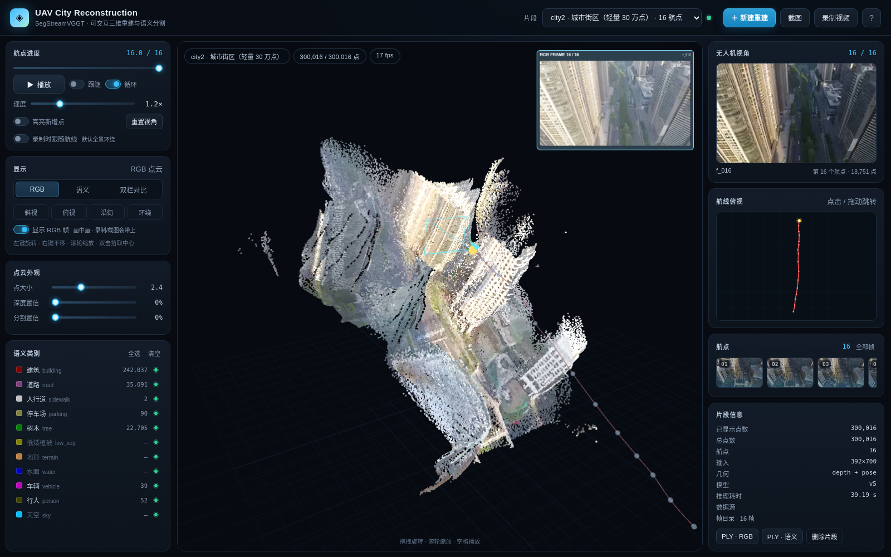
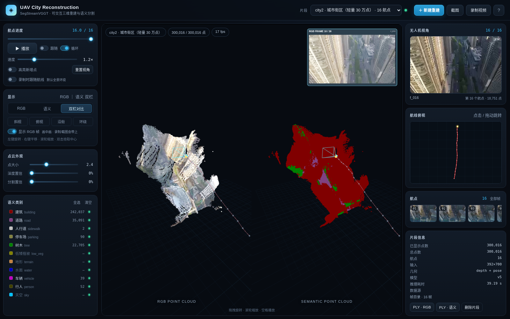
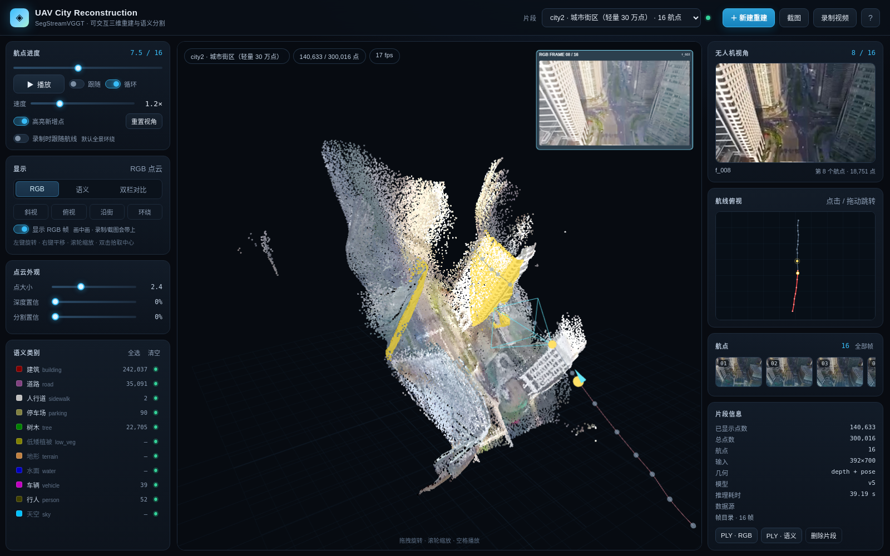
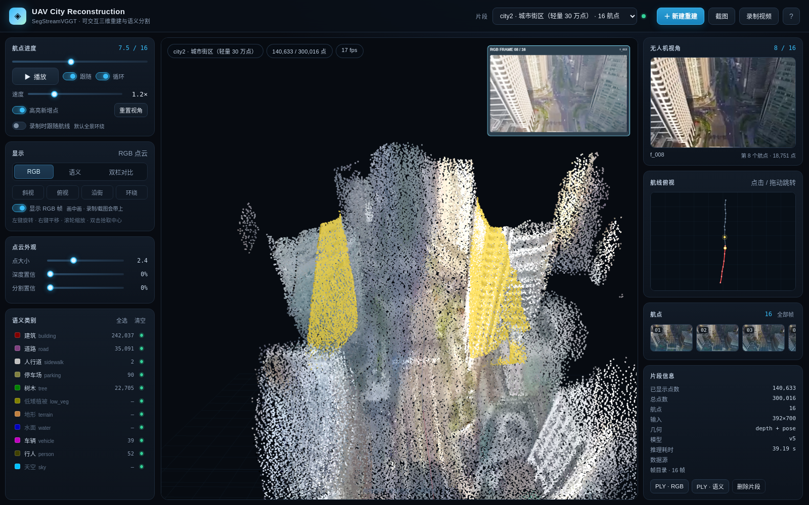
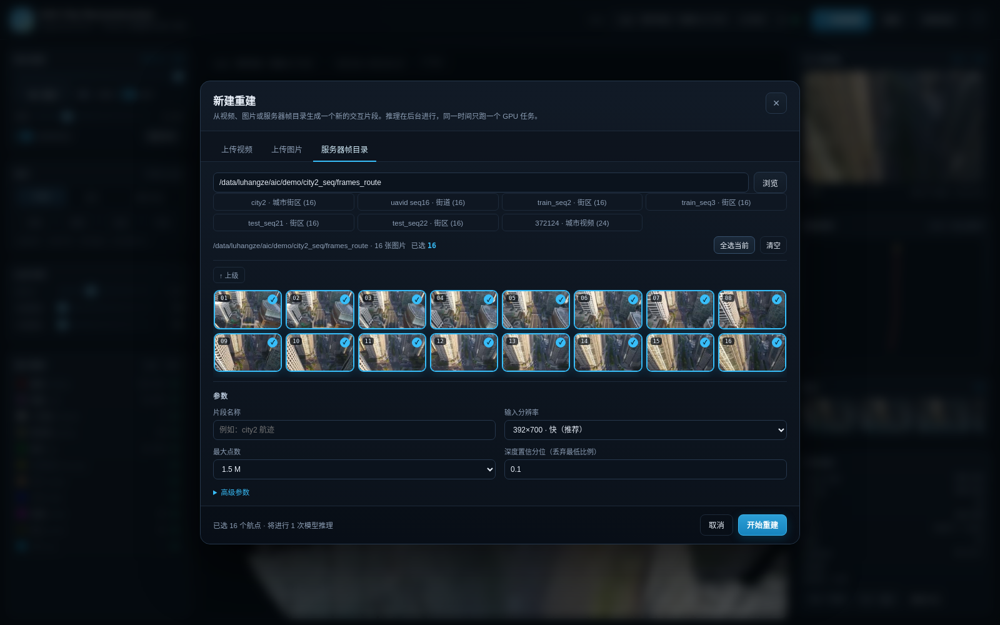
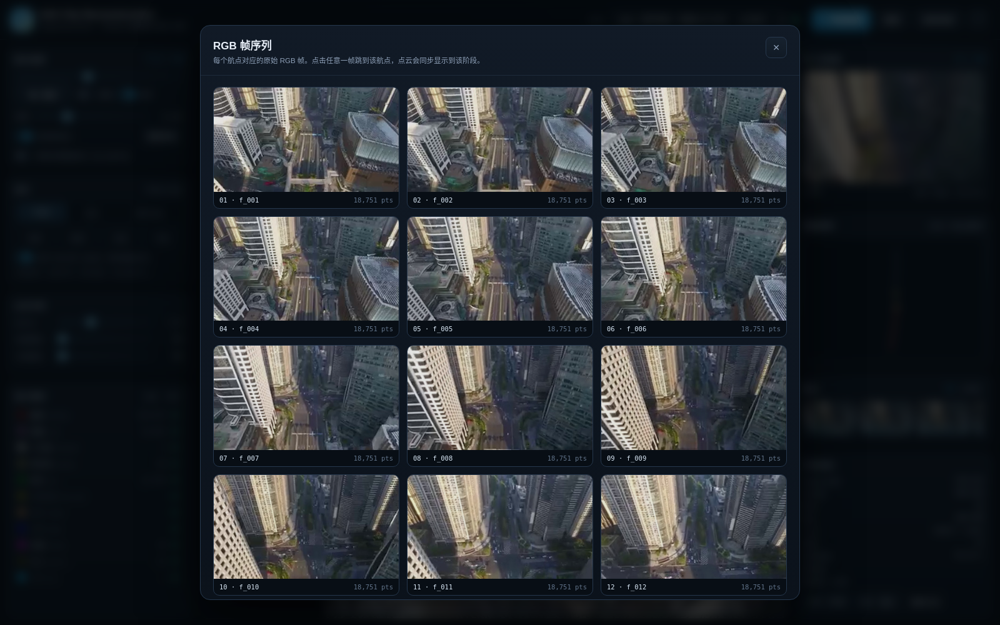
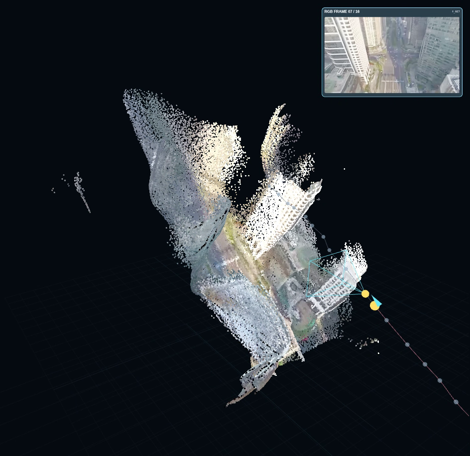

# AIC · 无人机城市重建与分割（交互式 Web Demo）

把 `SegStreamVGGT/demo/demo_uavid_route.py` 的离线批量渲染流程，改造成一个**浏览器里实时可操作**的
三维重建 + 语义分割演示：一次推理得到点云/相机/语义缓存，之后旋转、缩放、切换视角、沿航线飞行、
过滤类别、导出截图/视频/PLY 都不需要重新跑模型。



> 截图使用 `city2 · 轻量 30 万点` 片段（无头浏览器软件渲染无法承受 150 万点）。实际浏览器在 GPU 上
> 直接加载完整的 150 万点片段。

| 双栏对比 | 增量补全（黄色为新增点） |
|---|---|
|  |  |

| 跟随航线 | 服务器帧目录向导 |
|---|---|
|  |  |

| RGB 帧序列（点击跳转） | 录制视频实际帧（右上角为 RGB 画中画） |
|---|---|
|  |  |


---

## 1. 快速开始

```bash
cd /data/luhangze/aic/make_demo
./run.sh                       # 默认 0.0.0.0:8787，每个任务自动选 GPU
# 或者
DEMO_GPU=0 DEMO_PORT=9000 ./run.sh  # 固定 GPU 0（调试用）
```

本机浏览器打开 **<http://127.0.0.1:8787>**。

### 给同学访问（校园网）

**<http://<PUBLIC-IP>:8787>** 或 **<http://<PUBLIC-IP>/>**（80 端口备用），**无需密码**。

链路：校园 NAT `<PUBLIC-IP>` → 实验室路由器（WAN `<ROUTER-WAN-IP>`）→ 本机 `<LAN-IP>:8787`。
路由器上已做 `8787/TCP` 和 `80/TCP` → `<LAN-IP>:8787` 的 UPnP 映射，校园网内可直接打开。
校外公网访问可能被校园防火墙拦截；如果同学在校外，可以用下面的 Tailscale/SSH 备用方式。

备用方式（Tailscale / SSH 本地转发）：

```bash
# 已有到 VPS 的反向隧道：http://<TAILSCALE-IP>:8787（tailnet 内）
ps aux | grep '[s]sh -N -R 8787'

# 或者在自己的电脑上做本地转发
ssh -N -L 8787:127.0.0.1:8787 <user>@<LAN-IP>
# 然后打开 http://127.0.0.1:8787
```

> demo 没有登录鉴权，校园网内可直接访问；如果不再需要 Tailscale 备用，可执行
> `pkill -f 'tunnel_vps[.]sh'; pkill -f 'ssh -N -R 8787'` 关闭。

> 如果页面停在“正在连接服务”，先强制刷新一次（Ctrl+F5 / Cmd+Shift+R）。服务端首页已设 `no-store`，
> 并且新 `app.js` 对旧 HTML 做了空值兼容；12 秒仍未连上时会显示具体错误和“重新加载”按钮。

首次打开会加载当前最新的重建场景（可能达到 4700 万字节级别，例如 47.7 MB 的 400 万点场景），
加载时显示的是“加载片段… + 进度”，不是连接卡死。
加载完成后默认显示**完整重建**；点“播放”会从第 1 个航点开始，按航线逐段补全点云。

运行环境（已配置好）：

| 项 | 值 |
|---|---|
| Python | `/data/luhangze/miniconda3/envs/segvggt/bin/python` |
| 几何/相机权重 | `/data/luhangze/aic/StreamVGGT/ckpt/checkpoints.pth` |
| 分割权重 | `/data/luhangze/aic/SegStreamVGGT/logs_aic_v5/checkpoint_best.pth` |
| GPU | 默认 `auto`，每个任务按实际显存/利用率选卡；`DEMO_GPU=2` 可固定 |
| 依赖 | torch 2.3.1+cu121, fastapi, uvicorn, numpy, scipy, PIL, open3d(可选) |

> 本次还补齐了 `segvggt` 环境里缺失的 `typing_extensions`、`mpmath`、`cycler`、`kiwisolver`、
> `fonttools`、`pyparsing`、`contourpy`。网页版本身只需要 torch/numpy/scipy/PIL，
> matplotlib 仅用于可选的离线批量脚本。

---

## 1.1 场景管理与大数量选帧

### 场景管理

顶栏 **场景管理** 打开全部已重建场景列表，每行提供：

- **打开**：切到该场景。
- **重建**：使用 `meta.json` 里保存的原始 `source`（帧目录 / 视频 / 图片）和 `params`，创建一个**新场景**；
  旧场景保留。对应接口 `POST /api/clips/{clip_id}/rebuild`，支持 `?dry_run=1` 只校验原始输入是否还在。
- **删除**：只删除 `data/clips/<id>/` 点云缓存；原始视频/图片/帧目录保留。对应接口
  `DELETE /api/clips/{clip_id}`。若该场景正在重建，会拒绝删除。

早期图片场景没有保存原图路径时，重建会提示缺少原始输入；新的图片场景已经会保存 `paths`。

### 视频均匀选帧

- 上传视频仍只抽 **20 个候选缩略图**用于浏览/微调，但 **均匀选择** 的上限是 **1000 帧**：
  输入 N 后会直接按视频总帧数生成 N 个均匀索引，显示在候选条下方的摘要里。
- 缩略图区只展示 20 个候选；选 1000 帧时不会渲染 1000 张缩略图，提交后由 `recon.py` 按索引逐帧抽取。
- 提交接口与 `max_frames` 上限均为 **1000**。帧数越多，显存占用和推理时间越大，常规演示建议 16–32 帧。
- **模型单次推理有显存硬上限**：全局 attention 是 `(S*P)^2`，单次预算约 47k tokens。
  392×700 约 **32 帧**、518×924 约 **19 帧**；超出会在抽帧前均匀降采样，任务不会 OOM。
  1000 是“选帧覆盖范围”的上限，不代表一次前向 1000 帧；实际航点数看 `meta.params.max_frames`。
- 2026-10-20 的 100 帧 P12 任务在抽帧修复后暴露出 73.54 GiB OOM；现已按上述 token 预算在推理前降采样。
- 上传时会尽量补齐 20 个候选；若某个 seek 失败，会在相邻帧重试，不再出现“只抽到 19 帧”。
- 重建抽帧同样有容错：末帧/时间戳取整导致 fast seek 空帧时，会用 accurate seek 和 ±1/±2/±3 邻帧重试；
  单帧仍失败只会跳过并记录，不会让整个 100/1000 帧任务直接失败（至少保留 2 帧）。

---

## 2. 与原始脚本相比改了什么

原始流程（`demo_uavid_route.py`）：

```
16 帧 → 模型推理 → 提取点云 → 为每个 (航点, 视角, RGB/语义) 用 matplotlib 画一张图
      → 76 张 PNG → ffmpeg 合成 mp4
```

问题：视角在命令行里写死；改一个仰角/方位角要重新渲染全部 76 帧；换一组航点还要重新推理；
RGB 与语义只能并排看，无法交互过滤。

新流程：

```
帧目录/视频/图片 → 后台 recon.py 推理一次 → data/clips/<id>/
                                              ├─ points.bin   20 B/点（位置/RGB/类别/航点/显现rank/置信度）
                                              ├─ meta.json    相机位姿、航线、调色板、统计
                                              └─ thumbs/      每个航点的原图缩略图
浏览器 ← FastAPI ← 上述缓存；Three.js 实时渲染
```

| 能力 | 原脚本 | 新 Demo |
|---|---|---|
| 视角 | 固定 elev/azim，改参数要重渲染 | 鼠标轨道/平移/缩放、4 个预设、双击拾取中心、跟随航线、自动环绕 |
| 航点与时间轴 | 固定 16 个航点，视频一次性生成 | 滑杆任意位置、航点缩略图跳转、俯视小地图拖动、播放/循环/速度 |
| 显示 | RGB/语义两栏静态图 | RGB / 语义 / 双栏对比、RGB 帧画中画、帧序列浏览 |
| 过滤 | 只能改置信度参数后重跑 | 12 类单独开关、深度置信/分割置信滑杆、点大小实时调 |
| 增量补全 | 预渲染 76 帧 | 连续时间轴 + 近→远 reveal + 黄色高亮新增点 |
| 换输入 | 改命令行 `--image-dir` | 网页上传视频/图片，或浏览服务器帧目录，勾选任意航点 |
| 导出 | mp4 + PLY | 当前视角 PNG、WebM 视频（含 RGB 帧画中画）、RGB/语义 PLY |
| 复用 | 每次重跑推理 | 缓存片段，秒开；后台任务队列 |

### GPU 自动选择

服务默认 `--gpu auto`，每个重建任务在启动时查询 `nvidia-smi`：

- 优先选择空闲显存 ≥ 16 GB 的卡；
- 按 `free_mb - utilization% × 300 MB` 打分，避免选到 100% 占用但显存大的卡；
- 选中结果写入任务日志（`$ GPU 2 [auto: free=... util=...]`）和 `/api/jobs` 的 `gpu` 字段；
- `DEMO_GPU=2 ./run.sh` 或 `--gpu 2` 仍可手动固定，便于调试。


关键实现差异：
1. **坐标**：原脚本用 matplotlib 的 Z-up 显示 `(x, z, -y)`；网页用 Three.js Y-up，缓存里统一为
   `(x, -y, z)`。
2. **点采样**：原脚本全局随机下采样，可能把某个航点采空；新实现按航点等比例采样，保证每个航点都有点。
3. **每点额外属性**：`wp`（航点）、`rank`（距上一相机由近到远的显现顺序）、`conf`（逐帧深度置信
   分位）、`prob`（语义最大概率），因此过滤和增量显现完全在前端完成。
4. **双栏**：同一场景在左右两个 viewport 各渲染一次，动态加宽 FOV 保证两边都能看到完整场景。

---

## 3. 网页功能

### 视角
- **左键拖拽**旋转，**右键拖拽**平移，**滚轮**缩放，**双击**把旋转中心放到点云上。
- `斜视` / `俯视` / `沿街` / `环绕` 四个预设。
- `跟随`：相机沿 PCHIP 平滑后的预测航迹飞行，隐藏无人机/视锥/航点标记，适合录巡检视频。
- `重置视角` 回到斜视全景。

### 时间轴与航点
- 顶部滑杆对应 `0 … K-1` 个航点，连续拖动可看到当前航点“近→远”补全。
- 播放速度 0.2–4 航点/秒；循环可开关。
- 右侧航点缩略图点击跳到对应航点；左下角俯视小地图可点击/拖动定位。
- 右侧上方“无人机视角”显示当前航点对应的输入原图；点击右侧“全部帧”可打开 RGB 帧序列，查看/跳转任意航点的原图。
- 3D 视口右上角有**当前 RGB 帧画中画**（可直接出现在截图和录制视频里），可在“显示”卡片里开关。

### 显示与过滤
- `RGB` / `语义` / `双栏对比`。
- 12 个语义类别（AIC-11 + unlabeled）单独开关，右侧显示全局点数。
- 深度置信、分割置信滑杆实时过滤；点大小 0.6–6。
- `高亮新增点` 把当前过渡中新加入的点染成黄色（默认关闭，可手动开启）。

### 导出
- `截图`：合成当前 canvas + 标题/航点信息，PNG 下载。
- `录制视频`：从第 1 个航点开始播放完整航线，`MediaRecorder` 录成 WebM 下载
  （约 12.5 s，取决于速度）。默认**全景环绕**，勾选“录制时跟随航线”可改成无人机跟随视角。
  **RGB 帧画中画会一起录进视频**；录制前即使关闭画中画，录制时也会自动打开，结束后恢复。
  录制中点击红色 REC 可停止。
- `PLY · RGB` / `PLY · 语义`：按需生成二进制 PLY（MeshLab / Open3D 可打开）。

### 新建重建（网页向导）
- **上传视频**：上传后自动抽取 20 个候选帧（ffmpeg 快速 seek），在网格里勾选任意帧作为航点，
  支持“均匀选择 N 帧”。提交后后台按选中帧号精确抽帧 + 推理。
- **上传图片**：多选图片，按文件名排序，勾选任意张作为航点。
- **服务器帧目录**：输入路径浏览（默认限制在 `/data/luhangze`、`/data1`、`/tmp` 和 demo 数据目录下），
  可进入子目录；内置 city2、uavid seq16、train_seq2/3、test_seq21/22、372124 等快捷入口。
- 参数：分辨率、最大点数、深度置信分位、语义阈值、新增点距离、是否去天空、depth/point 几何来源。
- 提交后显示进度、阶段和实时日志；同一时间只跑一个 GPU 任务，其余排队；可取消。
- 任务完成后自动刷新片段列表并加载新片段；刷新页面会重新接上仍在运行的任务。

---

## 4. 目录结构

```
make_demo/
├── server.py               # FastAPI：静态页、片段、上传、抽帧、后台任务、PLY
├── core.py                 # 推理核心（从原脚本重构；无 matplotlib，轻量可被 server 导入）
├── recon.py                # 单任务 worker：抽帧→推理→过滤→写缓存，输出进度 JSON 行
├── demo_uavid_route.py     # 原始离线批量脚本副本（legacy，保留对照/批量 mp4）
├── run.sh                  # 启动 Web 服务
├── tunnel_vps.sh           # 反向 SSH 隧道（把 8787 暴露到 VPS Tailscale IP，自动重连）
├── requirements-web.txt    # 网页版额外依赖（fastapi/uvicorn/python-multipart）
├── static/
│   ├── index.html
│   ├── style.css
│   ├── app.js              # Three.js 场景、交互、向导、任务轮询、导出
│   └── vendor/             # three.module.js + OrbitControls（已本地化，无需联网）
├── tools/subsample_clip.py # 由完整片段生成轻量副本（低配机器/分享用）
├── data/
│   ├── clips/              # 片段缓存（meta.json + points.bin + thumbs/）
│   ├── uploads/            # 上传的视频/图片/候选帧
│   └── work/               # 抽帧、任务请求、缩略图缓存
├── docs/                   # README 截图
└── logs/
```

### 片段缓存格式

`meta.json` 关键字段：

```json
{
  "id": "city2-demo",
  "label": "city2 · 城市街区（完整 150 万点）",
  "num_points": 1500000,
  "num_waypoints": 16,
  "counts": [93750, ...],
  "offsets": [0, ...],
  "bounds": [[...], [...]],
  "route": [[x,y,z], ...],
  "waypoints": [{"i":0,"name":"f_001","cam":[...],"R":[9 floats],"fov":[h,w],"thumb":"thumbs/w000.jpg","count":93750}],
  "palette": [[...], ...],
  "class_names": [...],
  "params": {...},
  "source": {...}
}
```

`points.bin` 为 planar little-endian，总 `20 * N` 字节：

| offset | 类型 | 内容 |
|---|---|---|
| `0 .. 12N` | float32 × 3N | 位置（Three.js Y-up） |
| `12N .. 15N` | uint8 × 3N | RGB |
| `15N .. 16N` | uint8 × N | 类别 id |
| `16N .. 17N` | uint8 × N | 航点索引 |
| `17N .. 18N` | uint8 × N | reveal rank（0–255，按距上一相机由近到远） |
| `18N .. 19N` | uint8 × N | 深度置信分位 |
| `19N .. 20N` | uint8 × N | 语义最大概率 × 255 |

浏览器直接把这些切片挂成 `BufferAttribute`（零拷贝），shader 里做显现/类别/置信度过滤。

---

## 5. HTTP API（便于脚本化）

| 方法 | 路径 | 说明 |
|---|---|---|
| GET | `/api/health` | 权重/GPU/片段数 |
| GET | `/api/config` | 类别、调色板、默认参数、服务器帧目录预设 |
| GET | `/api/clips` | 片段列表 |
| GET | `/api/clips/{id}/meta` | 片段元数据 |
| GET | `/api/clips/{id}/ply?mode=rgb|seg` | 下载 PLY |
| DELETE | `/api/clips/{id}` | 删除片段 |
| GET | `/clips/{id}/points.bin` | 点云二进制 |
| GET | `/api/browse?path=...` | 浏览服务器目录（受 allowed roots 限制） |
| GET | `/api/frames/thumb?path=...&w=320` | 图片缩略图（带磁盘缓存） |
| POST | `/api/upload/video?candidates=20` | 上传视频并抽候选帧 |
| POST | `/api/upload/images` | 上传图片（multipart `files`） |
| POST | `/api/recon` | 提交重建任务 |
| GET | `/api/jobs/{id}` | 任务进度/日志 |
| POST | `/api/jobs/{id}/cancel` | 取消任务 |

提交示例：

```bash
curl -X POST http://127.0.0.1:8787/api/recon \
  -H 'Content-Type: application/json' \
  -d '{
    "label": "my route",
    "source": {"kind": "frames", "paths": [
      "/data/luhangze/aic/demo/city2_seq/frames_route/f_001.png",
      "/data/luhangze/aic/demo/city2_seq/frames_route/f_005.png",
      "/data/luhangze/aic/demo/city2_seq/frames_route/f_010.png"
    ]},
    "params": {"img_size": "392x700", "max_points": 1500000, "conf_quantile": 0.1}
  }'
```

---

## 6. 性能与低配机器

- 一次重建：模型加载约 30–40 s，16 帧前向约 6–8 s，总约 40 s（4090，392×700）。
- 150 万点需要可用的 WebGL GPU；集显/软件渲染建议使用轻量片段。
- 生成轻量副本：

```bash
python tools/subsample_clip.py \
  --src data/clips/city2-demo --dst data/clips/city2-lite \
  --stride 5 --label "city2 · 城市街区（轻量 30 万点）"
```

- 修改点数上限：向导里的“最大点数”，或 POST 参数 `max_points`。
- 输入分辨率注意是 **H×W**：横屏用 `392x700`（推荐）或 `518x924`；竖屏用 `700x392` 或 `924x518`。
- 显存：16 帧 392×700 约 15–20 GB；更高分辨率 `518x924` 更慢、更吃显存。

---

## 7. 已知限制

- 几何头是**冻结的 StreamVGGT 预训练权重**，未在 AIC/UAVid 上微调；UAVid 斜视 + 大间隔会导致
  建筑立面“扇形”拖尾和外点。这是定性 demo，不是几何精度评测。
- 没有做多帧深度融合、TSDF/泊松重建、回环或位姿优化；没有跨帧标签投票。
- 语义颜色是**模型预测**，不是 GT；当前 v5 权重在该片段上以 `building` 为主。
- 视频抽帧用 `ffmpeg -ss` 快速 seek，极少数关键帧可能不是精确帧号；对航点选择影响可忽略。
- 同一时间只跑一个 GPU 重建；多个请求会排队。
- 浏览器录制的 WebM 由 `MediaRecorder` 生成，可能没有 duration 元数据，但可正常播放。
- 上传文件保存在 `data/uploads/`，不会自动清理；可在页面删片段，上传目录需手动清。
- 服务和数据都在本机；没有登录/多用户隔离，适合内网 demo。

---

## 8. 原始脚本副本

`demo_uavid_route.py` 是从 `SegStreamVGGT/demo/demo_uavid_route.py` 复制的原始批量脚本，
只改了 `ROOT` 的探测方式（指向 `SEGSTREAM_ROOT`），并加了说明头。它仍然可以：

```bash
cd /data/luhangze/aic/make_demo
CUDA_VISIBLE_DEVICES=2 python demo_uavid_route.py \
  --image-dir /data/luhangze/aic/demo/city2_seq/frames_route --max-frames 16 \
  --img-size 392x700 --out data/batch_output
```

但日常演示建议直接用网页版：同一份推理结果可以被任意视角复用，不需要为每个视角重复渲染。
